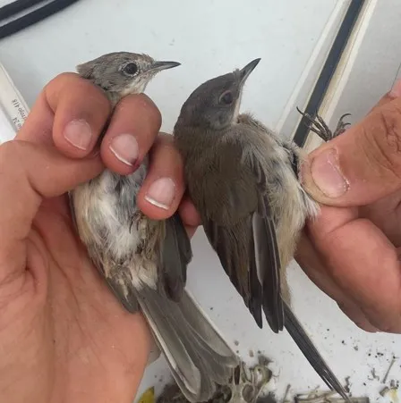
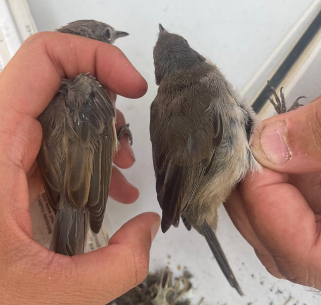
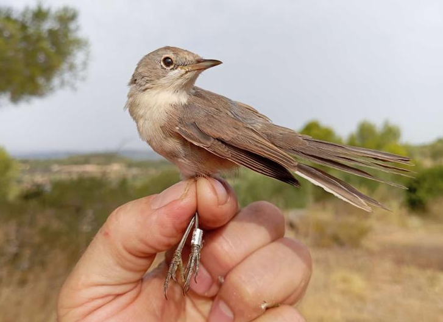

⚠️Disclaimer: Todas las fotos y la manipulación de las especies se hicieron con anilladores expertos en el marco de un voluntariado de anillamiento.

### ***Sylvia cantillans*** – Tallarol de garriga – Curruca carrasqueña vs ***Sylvia melanocephala*** – Tallarol capnegre – Curruca cabecinegra

En estas fotos comparamos dos ejemplares, a la izquierda, Sylvia cantillans joven, con un anillo ocular pálido. Los machos adultos tienen un anillo ocular rojo bastante claro y una bigotera blanca delgada. A la derecha, el juvenil de *Sylvia melanocephala* ya comienza a presentar su característico anillo ocular rojo.

{width=40%}

Otro carácter determinante es el rojizo o marrón rojizo en los bordes de las terciarias de la *Sylvia cantillans* comparada con los bordes mucho más oscuros de la Sylvia melanocephala. Esto se ve claro en la siguiente foto, pero se ve mucho más claro en esta entrada del blog del grupo de anilamiento álula donde las comparan con una tercera curruca que es la tomillera (*Sylvia conspicillata*).

{width=40%}

Finalmente, otro recurso muy útil es esta clave de Javier Blasco Zumeta y Gerd-Michael Heinze para la identificación de juveniles de curruca. Ahí, se menciona otro carácter fácil e interesante en el que, generalmente la primera primaria (en la guía 10ª) es de la misma longitud que las cobertoras primarias para la Sylvia cantillans, mientras que es más larga para la *Sylvia melanocephala.*

Aquí dejo también una foto de un juvenil de *Sylvia cantillans* tomada por Eladi Ribes en el Parapeu (Bovera, Lleida).

{width=50%}
